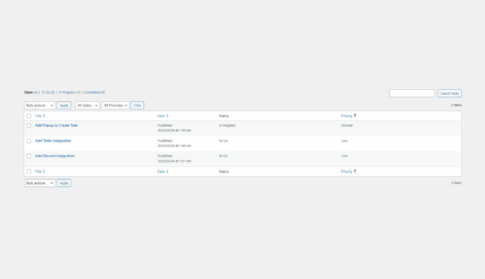
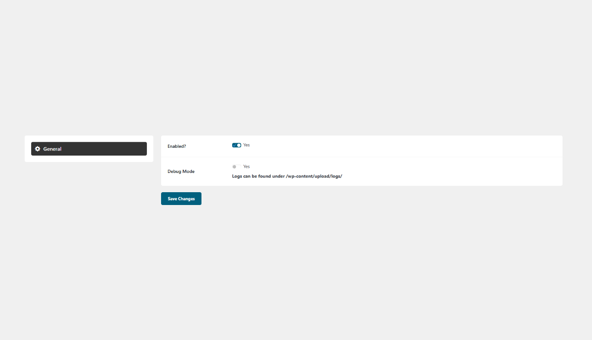

## Description

ProjectPlot is a powerful and intuitive WordPress plugin that transforms your WordPress backend into a centralized hub for managing tasks. There are of course tools out there for project management, but for small businesses it's generally a lot of extra steps just create a task. This is built with small teams in mind, this way you can create tasks using a system you are already familiar with, without the need to load or install an additional application.

### Features

- Task creation
- Set task name
- Set task description
- Set task priority
- Set task status
- ClickUp integration via our [ProjectPlot Suite](https://www.dogbytemarketing.com/shop/projectplot-suite/)

## Roadmap

- Add ability to add projects and have it filterable
- Add additional integrations

## GDPR

We are not lawyers and always recommend doing your own compliance research into third party plugins, libraries, ect, as we've seen other plugins not be in compliance with these regulations.

This plugin uses the Bootstrap, BootStrap Icons, and SweetAlert2 3rd party libraries. These libraries are loaded locally to be compliant with data protection regulations.

This plugin collects and stores certain data on your server to ensure proper functionality. This includes:

* Storing plugin settings
* Remembering which notices have been dismissed

This plugin uses third party services such as the connection to ClickUp via Dog Byte Marketing's [ProjectPlot Suite](https://www.dogbytemarketing.com/shop/projectplot-suite/) to send and receive data from ClickUp such as creating a task, or creating a webhook for monitoring the task. You can see the respective policies here:
[Dog Byte Marketing Terms of Service](https://www.dogbytemarketing.com/terms-of-service/)
[Dog Byte Marketing Privacy Policy](https://www.dogbytemarketing.com/privacy-policy/)
[ClickUp Terms of Service](https://clickup.com/terms)
[ClickUp Privacy Policy](https://clickup.com/terms/privacy)

## Installation

1. Backup your WordPress site.
2. Upload the plugin files to the `/wp-content/plugins/` directory, or install the plugin through the WordPress plugins screen directly.
3. Activate the plugin through the 'Plugins' screen in WordPress.

## Screenshots

## Changelog

### 1.1.0
* Added: API so you can access tasks in other applications without going to the backend
* Bugfix: Completed tasks not showing when filtering by Completed.

### 1.0.1
* Updated: Translations

### 1.0.0
* Initial Release